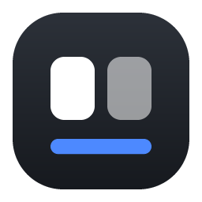
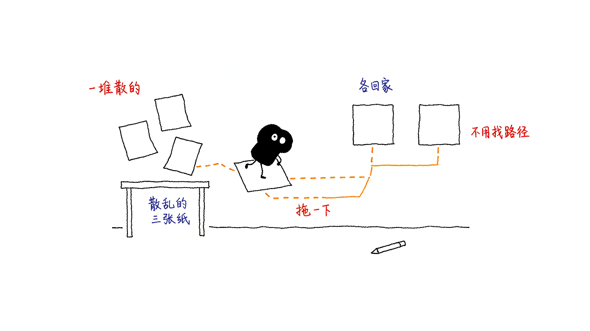
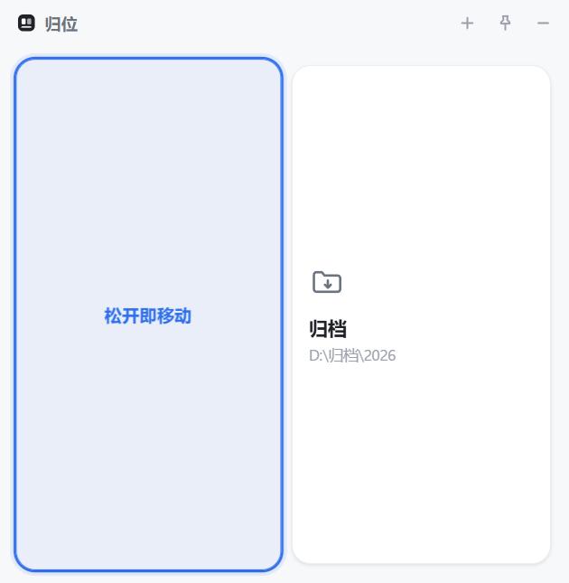
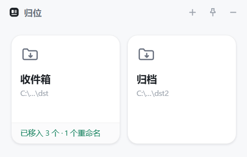
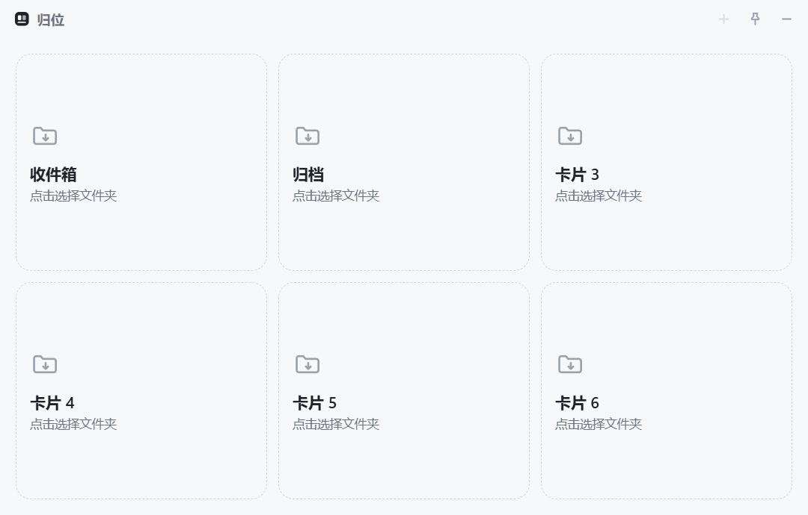
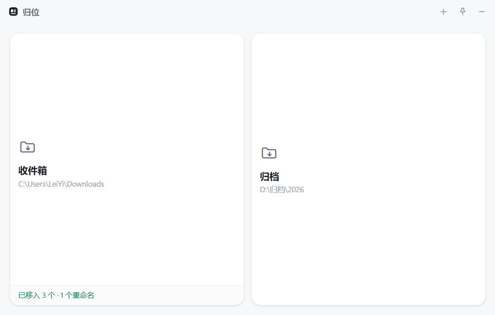
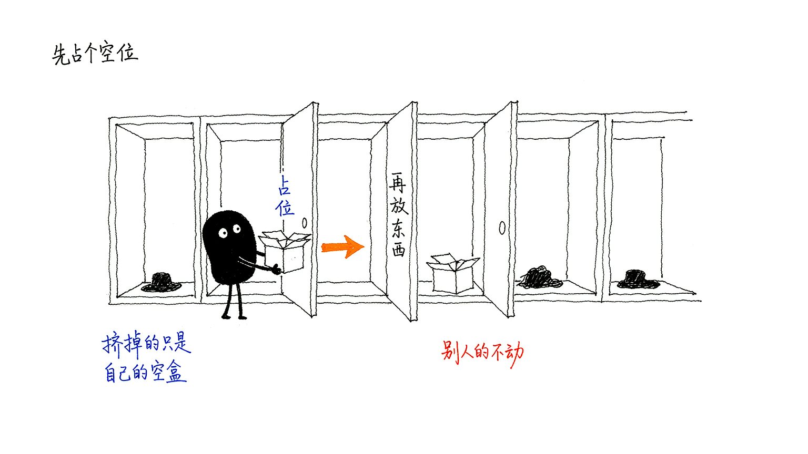
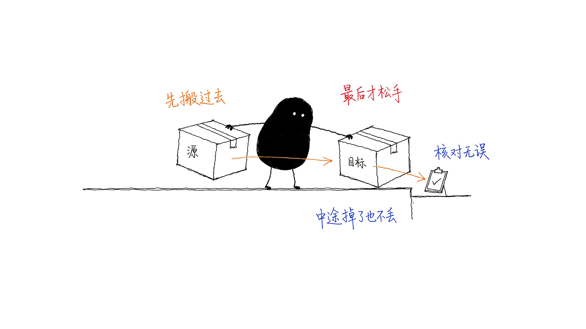
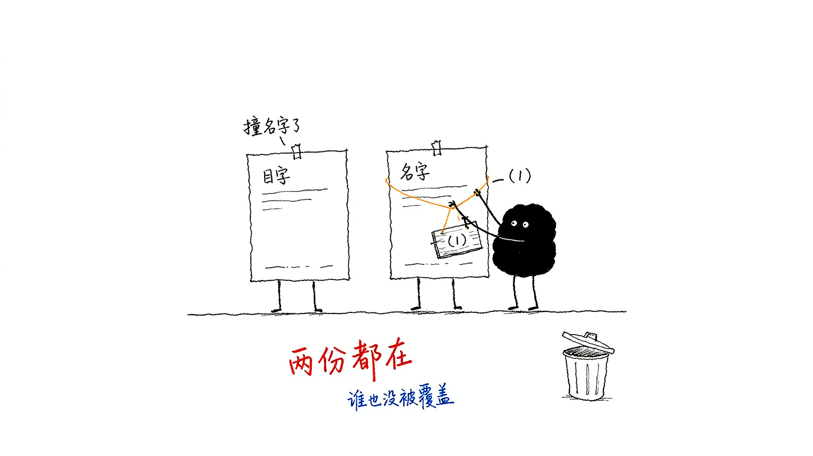
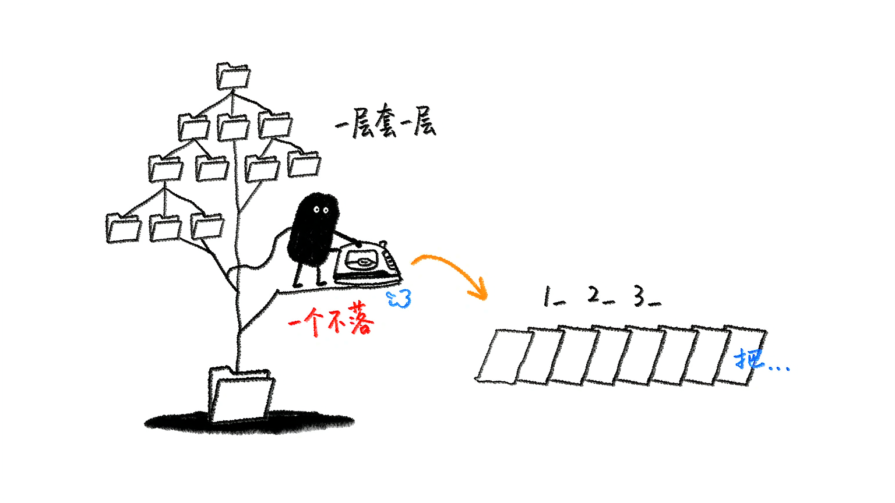

<div align="center">



# 归位 FileCards

**桌面上的第二只手：文件拖到哪儿，它自己就走过去。**

Windows · 免安装 · 不联网 · 不覆盖 · 不丢文件

[](LICENSE)
[](#系统要求)
[](https://www.electronjs.org/)
[](#测试)

</div>



---

## 这是什么

每天都会有几样东西反复从你手里路过：下载的发票、导出的报表、客户发来的素材、桌面上越来越多的截图。它们的去处其实早就固定了，可每次还是得——打开资源管理器，一层层点进目录，再点回来。

**FileCards 把「去处」变成桌面上一排方格子。** 你把文件拖进去，松手，它就已经在那个文件夹里了。不用打开窗口，不用找路径，不用记得上次是放在「2026 / 10 / 客户A」还是「客户A / 2026 / 10」。

它只做这一件事，而且把它做得足够小心：**宁可停下来说失败，也绝不把文件放到错误的位置、绝不覆盖任何已有文件。**

> 这个项目的全部复杂度，都花在「怎么保证不丢」上，而不是「怎么长得更花哨」上。如果你只想要一个能拖放的窗口，几十行代码就够了；如果你想让它敢接住你唯一一份的合同扫描件，就得往下看那三条保证。

## 30 秒上手

从 [Releases](https://github.com/leiyi/file-cards/releases) 下载，解压或直接双击，没有任何安装步骤：

| 下载 | 适合 | 说明 |
|---|---|---|
| `FileCards-1.0.0-portable.exe` | 想只留一个文件 | 单文件，双击即用（105MB）。首次启动会把文件解到临时目录，**冷启动约 3–5 秒** |
| `FileCards-1.0.0-win.zip` | 打算长期用 | 解压到任意目录，双击 `FileCards.exe`（146MB）。**启动更快，不会在临时目录留东西**，推荐 |

首次运行 Windows 可能弹出 SmartScreen「已保护你的电脑」——这是**未签名程序的通用提示**，不是病毒警告。点「更多信息 → 仍要运行」即可。签名证书需要每年付费，个人项目暂时没有。

启动后：

1. 点一下卡片，选一个目标文件夹（卡片会显示这个目录名）。
2. 从资源管理器把文件或文件夹**拖进卡片**，松手就移动完了。
3. 点右上角 `+` 加卡片，最多 6 张；卡片的 `×` 删除，右键有更多菜单。
4. 关掉窗口不会退出，它会缩到系统托盘，点图标回来。

## 界面

| 初始状态 | 拖进来时 | 移动成功 |
|---|---|---|
|  |  |  |

| 失败明细（可点开定位文件） | 六张卡片 | 拉大窗口后 |
|---|---|---|
|  |  |  |

窗口本身是无边框的，**卡片会一直铺满整个窗口**——拖窗口的四条边或四个角改大小，与边缘的留白恒定 14px，卡片之间的间距恒定 10px，间距和留白不会因为窗口变大而变松。

## 绝不弄丢文件的三条保证

这是整个项目真正的重点。下面三条都是代码里的硬实现，不是界面上的提示语。

### 一、先占名，再写入



Windows 上的 `fs.rename` 等价于 `MoveFileEx(..., MOVEFILE_REPLACE_EXISTING)`：**目标有同名文件时会静默替换、不报错**。也就是说，一个不小心的 rename，就能让别人的文件人间蒸发，而且没有任何返回值告诉你发生了什么。

所以每次落盘都分两步：

1. 用 `open(path, 'wx')`（即 `CREATE_NEW`）**原子地抢占**目标文件名，得到一个 0 字节的占位文件。抢不到说明名字已被占用，换下一个候选名。
2. 把源文件 rename 到**我们自己刚创建的那个占位文件**上。

被覆盖的永远是自己创建的空文件，不可能是别人的数据。「是否存在同名」这件事也完全交给文件系统裁决——大小写不敏感（`Report.PDF` vs `report.pdf`）、Unicode 变体、并发抢占，全都天然正确，代码里没有一处靠字符串比大小写。

### 二、删源永远是最后一步



同盘移动是两次 rename，很快；跨盘移动没法 rename，只能复制。跨盘路径严格按这个顺序：

```
复制到目标目录内的临时名
      ↓
校验（大小必比，≤8MB 再比 SHA-256）
      ↓
占名（同第一条的 open 'wx'）
      ↓
原子改名成正式文件
      ↓
断言正式文件确实存在且大小正确
      ↓
最后一步：删源
```

前五步任何一步失败，结果只可能是**「源还在」**，绝不会是「少一份」。第六步删源如果失败，会返回成功 + 一条黄色提示「两份都在」——不回滚、不报失败，因为两份都在是最安全的状态。

进程被强杀也没关系：最坏情况是目标目录里残留一个 `.wbmove-xxx.tmp` 临时件，**那是副本，不是损失**。

### 三、文件夹整体移动，绝不合并

把文件夹拖进卡片时，整棵树作为一个整体移动，只判最外层的重名（`项目` → `项目 (1)`）。

一旦改成「把文件夹里的每个文件搬进目标目录」，语义就变成了 merge：内部同名冲突、部分成功、半棵树在旧位置半棵在新位置——这是丢数据的经典路径。所以它**不做**这件事，哪怕 merge 看起来更方便。

### 还有这些会被直接拒绝

不是报错崩掉，是明确告诉你为什么不动：

- 把父文件夹拖进它自己的子目录（会递归套娃）
- 把磁盘根目录、`C:\Windows`、`C:\Program Files` 拖进来
- 移动符号链接 / junction（目标可能是任意位置）
- 源文件在复制过程中被改动（大小变了）
- 目标盘空间不足
- 批量拖入时其中一个失败 → 其余照常完成，失败的单独列出，**不会因为一个失败而全部回滚**

## 同名文件怎么处理



目标目录已有同名项时，新文件自动改名为 `报告 (1).pdf`，**原有的那份和新的那份都在**，卡片底部会告诉你实际落盘的名称。连续拖同名文件会依次得到 `(1) (2) (3)`。

复合扩展名按整体识别：`backup.tar.gz` → `backup (1).tar.gz`（而不是 `backup.tar (1).gz`）。

## 批量收集：把一个文件夹摊平到另一个文件夹



顶部「收集」打开一个独立小窗口（托盘菜单里也有「收集文件…」）。两个框各拖一个文件夹进去，或者点一下选，然后开始。

| 空闲 | 完成 |
|---|---|
|  |  |

适合这种场景：课程视频散在 `第1讲/`、`第2讲/` 十几个子目录里，你想把它们按顺序摊平到一个文件夹，直接丢进播放器。

| 规则 | 说明 |
|---|---|
| 递归到底 | 子文件夹一层层扫下去，所有文件**平铺**到目标，不保留目录结构 |
| 序号前缀 | 按子文件夹顺序加前缀：`1_开场.mp3`、`2_主曲.mp3`。序号按整批连续推进，深层同名不会串号 |
| 绝不覆盖 | 目标里已有同名，自动改成 `1_a_1.txt`、`1_a_2.txt`，两份都在 |
| 默认只复制 | 源文件夹一个字节都不动；勾了「移走后删除原文件」也是**复制校验通过之后**才删 |
| 目标不存在 | 自动创建（多级也行） |

会被拒绝的情况：源和目标填成同一个目录、目标填在源里面（否则会自己收自己，越收越多）、源路径其实是文件、文件夹里一个文件都没有。符号链接不会被跟进，避免收进源文件夹之外的东西。

每个文件的落盘复用同一套保护。中途点「停止」，当前文件写完就停，已经收下的留在目标里，源文件不受影响。

> 这个功能来自一个 Python 小脚本，原始实现用的是 `shutil.move`。这里换成了「复制 → 校验 → 占名 → 改名 → 最后删源」，代价是慢一点，换来的是中途断电也不会少文件。

## 操作结果怎么看

- **成功**：卡片底部出现绿色「已移入 3 个 · 1 个重命名」
- **有失败**：橙色「1 成功 · 1 失败 ›」，**点一下**弹出明细，每条都能点开文件在资源管理器里的位置
- 有任何失败时卡片不会显示成功态——避免「看着成功其实漏了」

## 一些不显眼但有用的细节

| 细节 | 行为 |
|---|---|
| 窗口尺寸 | 自由缩放，最小 240×200；顶边不允许拖出屏幕（标题栏一旦看不见，窗口就再也拖不回来了） |
| 尺寸记忆 | 位置和大小写进配置，下次启动原样恢复 |
| 缩放中按 `Esc` | 放弃这次缩放，回到起始尺寸 |
| 加卡片 | 只在窗口小到放不下可读格子时才自动撑大，你手动设的尺寸不会被抢回去 |
| 卡片太矮 | 状态条自动收成一行；再矮就隐藏图标、缩小标题——不会挤成乱码 |
| 托盘常驻 | 关窗不退出；托盘菜单可显示/隐藏窗口、开收集、置顶、退出 |
| 窗口置顶 | 标题栏图钉，开关状态会记住 |
| 多开 | 单实例锁，重复双击只会把已有窗口叫到前面 |
| 拖放导航 | 三层防护确保「把文件拖进窗口」不会变成「用窗口打开这个文件」 |

## 它不做什么

明确划掉的功能，和做了一样重要：

- **不做撤销**。撤销需要记录每个文件的原路径，而它可能已经被别的程序改过。宁可把力气花在「没有需要撤销的情况」上。
- **不监听文件夹**，不会自动帮你整理 Downloads。什么时候归位由你决定。
- **不移动文件夹内的内容**（拖动卡片时），也不做 merge 语义。
- **不写操作日志文件**，不在后台留任何常驻服务。
- **不联网**，没有任何遥测、检查更新、账号体系。整个程序没有一处 `fetch`。
- 暂时只有 Windows。macOS 可以跑（`fs.rename` 覆盖语义不同，mover 的占名逻辑依然成立），但没有做适配和测试，所以不发版。

## 系统要求

- Windows 10 1809 及以上 / Windows 11，x64
- 不需要 .NET、不需要运行库、不需要管理员权限
- 安装包不写注册表，删掉文件夹即卸载干净

配置只有一个文件：`%APPDATA%\FileCards\config.json`（卡片目标目录、窗口位置、开关状态）。删掉它就恢复出厂。

## 开发

```bash
git clone https://github.com/leiyi/file-cards.git
cd file-cards
npm install
npm start
```

没有构建步骤：没有打包器、没有转译、没有框架，`src/` 里的文件就是运行时跑的原始文件。改完刷新（`Ctrl+R`）即可看到效果。

```bash
node test/mover.test.js      # 移动引擎用例矩阵 29 项
node test/collect.test.js    # 收集引擎用例矩阵 22 项
```

`src/mover.js` 和 `src/collect.js` **刻意不依赖 Electron**，只用 `fs/path/crypto`，所以能用纯 Node 跑完整的安全用例矩阵。这是整个项目最重要的一处取舍——「目标已有同名时到底谁被覆盖」这种逻辑，光靠手点几次是验不出来的。

### 目录结构

```
file-cards/
├─ src/
│  ├─ main.js               主进程：窗口、托盘、配置、IPC
│  ├─ preload.js            contextBridge，只暴露必要接口
│  ├─ collect-preload.js    收集弹窗的桥
│  ├─ mover.js              移动引擎（纯 Node，可单测）
│  ├─ collect.js            批量收集引擎（纯 Node，可单测）
│  └─ renderer/
│     ├─ index.html         主窗口
│     ├─ style.css
│     ├─ app.js             卡片渲染、拖放、自绘缩放热区
│     ├─ collect.html       收集弹窗
│     ├─ collect.css
│     └─ collect.js
├─ test/                    用例矩阵（不需要起窗口）
├─ scripts/                 图标生成、CDP 端到端与截图
├─ assets/                  应用图标、托盘图标
└─ docs/                    截图与配图
```

### 端到端测试

`scripts/` 下有几个通过 Chrome DevTools Protocol 驱动真实窗口的脚本，需要先带调试端口启动：

```bash
npx electron . --remote-debugging-port=9222

node scripts/cdp-eval.js "document.querySelectorAll('.card').length"
node scripts/cdp-shot.js out.png
node scripts/e2e-resize.js                  # 缩放与布局 25 项断言
CDP_PORT=9222 node scripts/e2e-collect.js   # 收集弹窗 35 项，含真实拖放
```

`e2e-resize.js` 用合成 `MouseEvent` 直接打到自绘的缩放热区上（`screenX/screenY` 可控），走的是真实链路：`mousedown → getBounds → mousemove* → setBounds → ResizeObserver 重排`。断言重点不是「卡片多大」，而是**四周留白恒为 14px、间距恒为 10px、卡片始终铺满、任何尺寸下都不出滚动条**。

`e2e-collect.js` 走真实交互：点顶部「收集」→ 等弹窗 → 用 CDP 把文件夹**真拖**进两个拖放区 → 点开始 → 核对磁盘落名、源目录是否原封不动、有没有残留临时件、配置是否落盘。它自己搭测试数据，跑前不需要准备任何东西。

### 打包

```bash
npm run build            # 同时产出 portable exe 与 zip
npm run build:portable   # 只出单文件 exe
npm run icons            # 重新生成 assets/ 下的图标
```

产物在 `release/`：单文件 exe 约 105MB，zip 约 146MB，解包后 357MB——里面装着一整个 Chromium，对 Electron 应用来说这是常态。

`win.zip` 的包体反而比单文件 exe 大，是因为 NSIS 的 portable 用的是更强的压缩算法，代价是每次启动都要解压一遍。

### 几个踩过的坑

留给后来人，省几个小时：

- **`ELECTRON_RUN_AS_NODE=1`** 会让 `electron.exe` 退化成纯 Node，启动直接报 `Cannot read properties of undefined (reading 'getPath')`。`start.bat` 里已经清掉了这个变量。
- **窗口拖到屏幕外，渲染进程会被判成 `hidden`**，视口度量和 `screenX` 全部冻结，量出来的尺寸全是陈的——看起来像布局 bug，其实是测量环境错了。测几何前必须先把窗口放回屏幕内。
- **量留白要用未取整的 `getBoundingClientRect()`**。`1fr` 均分会算出 262.5 这种小数，逐张 `round()` 再相减会凭空多出 1–2px，八项断言全红而布局完全正常。
- **`transparent: true` 和 acrylic 冲突**，而且会让 `thickFrame` 的圆角消失。窗口用 `frameless + roundedCorners` 就够。
- **`Input.dispatchDragEvent` 派发的 drop 总被降级成 dragleave**。要测真实拖放，得先 `DOM.setFileInputFiles` 拿到真实 `File` 对象，再自己构造 `DataTransfer` 派发 `drop`。

## 常见问题

**Q：会不会把我唯一的文件搞丢？**
不会。跨盘复制永远是「先复制、校验、落名，最后才删源」，任何一步失败源文件都还在。唯一的代价是可能留下一个临时副本（`.wbmove-*`），可以手动删。

**Q：为什么不做撤销？**
见[它不做什么](#它不做什么)。真需要找回，Windows 的回收站接不住 `rename`，但目标文件夹里一定有那份文件——它没有被覆盖过。

**Q：卡片最多只能 6 张？**
是的。再多就退化成文件管理器了，而它的价值恰恰是「去处是固定的几个」。要更多卡片，可以改 `src/main.js` 里的 `MAX_CARDS`，布局也会跟着算。

**Q：能拖整个分区的文件夹进去吗？**
会被拒绝。根目录、系统目录、父目录进子目录这几种情况都在拦截列表里。

**Q：杀毒软件报毒？**
未签名的 Electron 程序偶尔会被启发式引擎标红（尤其单文件 portable 版，因为它会自解压到临时目录）。源码全在这里，可以自己 `npm run build` 出一份。

## 隐私

- 不联网，不发任何数据，没有账号。
- 只读写你自己拖进来的文件和你自己选的目录。
- 配置存在 `%APPDATA%\FileCards\config.json`，仅含目录路径与窗口位置。

## 贡献

Issue 和 PR 都欢迎。提 PR 前请跑一遍 `node test/mover.test.js && node test/collect.test.js`。

**改 `mover.js` / `collect.js` 必须补用例。** 这两个文件承载的是「不丢文件」的承诺，没有用例覆盖的行为变更不要合。

## 许可

[MIT](LICENSE)。随便用，出事不负责——但请先看上面那三条保证，它们是我能给的诚意。

---

<div align="center">
<sub>图标、配图与代码都由作者本人制作 · 配图使用 Ian 小黑风格</sub>
</div>
